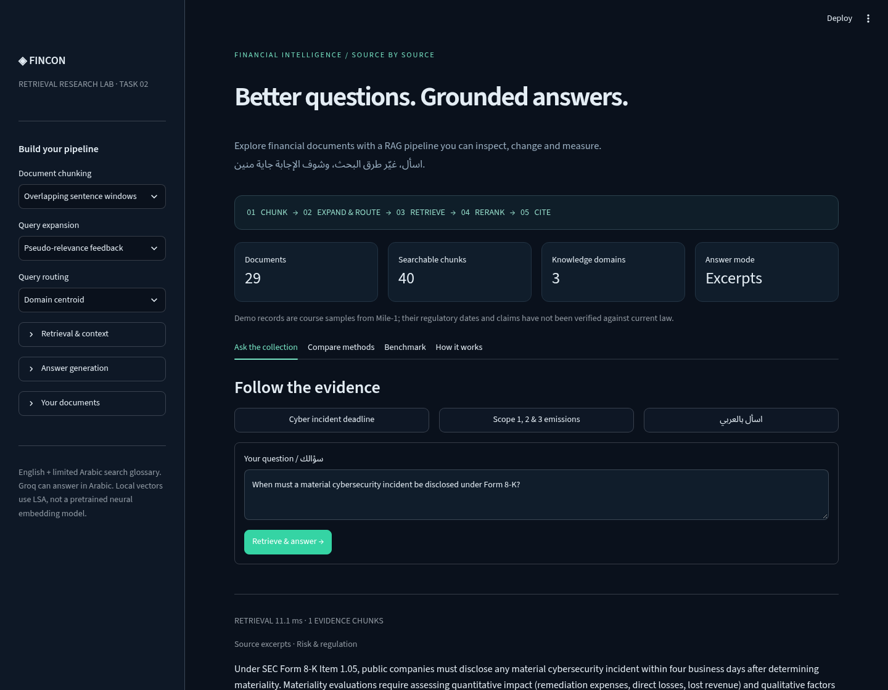

FinCon RAG Lab — John Khamis
===========================

**Project owner: [John Khamis](https://github.com/Yassahany2004)**

تطبيق RAG بـStreamlit

**رابط التطبيق:** يُضاف بعد نشر المستودع الجديد على Streamlit.

تم تفعيل Groq واختبار التوليد الحي مع PRF وHyDE وMulti-query والإجابة بالعربية مع مراجع المصادر. تقرير التوليد في `reports/groq-live-report.json`، وتقرير البحث والمقارنة ورفع الملفات والـBenchmark في `reports/live-deployment-report.json`.

[انشر هذا المستودع على Streamlit](https://share.streamlit.io/deploy?repository=Yassahany2004/fincon-rag-task&branch=main&mainModule=streamlit_app.py)



ما الذي تم تنفيذه؟
-----------------

| المرحلة | المنهج المرجعي | المنهج المستخدم |
| --- | --- | --- |
| تقسيم المستندات | Parent/Child بحجم حروف ثابت | Sentence windows بحد 80 كلمة أو فصل حسب التماسك اللفظي |
| Query expansion | spaCy وقاموس مالي | Pseudo-Relevance Feedback، Rocchio، Multi-query، HyDE |
| Query routing | لم أجد Router في الكود المرفق | تشابه مع Domain Centroids أو تصويت KNN |
| Retrieval | MiniLM + ChromaDB + BM25 | BM25L + بحث متجهات LSA محلي |
| Fusion | RRF | Weighted relative scores مع إتاحة RRF للمقارنة |
| Reranking | BGE Cross-Encoder | Maximal Marginal Relevance أو Relevance ordering |
| Context | استرجاع Parent chunks | ضغط باستخراج الجمل أو Neighbor windows |
| Generation | Groq مع تعليمات مراجع | Groq مع فحص معرفات المراجع والرجوع لمقتطفات عند الفشل |
| Evaluation | ملف التقييم الأصلي | 14 سؤالًا بعلامات على مستوى السجل، ومقارنة 4 إعدادات |

تشغيل محلي — Python 3.12
-----------------------

```bash
python -m venv .venv
```

Windows PowerShell:

```powershell
.venv\Scripts\Activate.ps1
```

Linux / macOS:

```bash
source .venv/bin/activate
```

ثم:

```bash
pip install -r requirements.txt
streamlit run streamlit_app.py
```

لا يحتاج التطبيق إلى FastAPI أو Elasticsearch أو Docker أو GPU أو تنزيل موديلات من Hugging Face. الفهرسة تتم تلقائيًا في الذاكرة.

تفعيل توليد الإجابات
-------------------

التطبيق يعمل بدون مفتاح ويعرض جملًا أصلية من المصادر مع مراجع. هذا وضع استرجاع واستخراج فقط؛ لتشغيل الـRAG التوليدي استخدم Groq.

أنشئ مفتاحًا من https://console.groq.com/keys ثم ضعه في Answer generation داخل الواجهة، أو انسخ ملف `.streamlit/secrets.toml.example` إلى `.streamlit/secrets.toml` محليًا واملأ المفتاح. في Streamlit Cloud ضعه في Secrets فقط.

```toml
GROQ_API_KEY = "your-own-key"
GROQ_MODEL = "openai/gpt-oss-20b"
```

اسم الموديل قابل للتغيير إذا تغيرت قائمة الموديلات المتاحة في حسابك. الإعدادات القديمة لـLlama 3.1 8B وLlama 3.3 70B تُحوّل تلقائيًا إلى GPT-OSS 20B بعد إيقاف إتاحتها للحسابات العادية، لذلك لا يلزم تغيير المفتاح أو إعادة إعداد الأسرار. يُستخدم reasoning_effort=low مع حد 4096 توكن لإكمال الإجابة. لا ترفع ملف الأسرار إلى GitHub. الأسئلة والمقاطع المختارة تُرسل إلى Groq عند التفعيل.

النشر على Streamlit Community Cloud
----------------------------------

1. افتح https://share.streamlit.io وسجّل بحساب GitHub، وأكمل إنشاء حساب Streamlit.
2. اربط GitHub وامنح Streamlit وصولًا لهذا الريبو.
3. اضغط Create app، ثم Yup, I have an app.
4. اختَر الريبو `Yassahany2004/fincon-rag-task` والفرع `main`.
5. Main file path: `streamlit_app.py`.
6. من Advanced settings اختَر Python 3.12 وأضف إعدادات Groq السابقة في Secrets لتفعيل التوليد.
7. اضغط Deploy. شارك رابط `streamlit.app` الذي يظهر بعد نجاح التشغيل.

التطبيق جاهز للنشر، لكن وجود الكود على GitHub ليس نشرًا على Streamlit. إنشاء الحساب وربطه والتأكد من ظهور رابط التطبيق خطوات مستقلة.

[دليل النشر الرسمي](https://docs.streamlit.io/deploy/streamlit-community-cloud/deploy-your-app/deploy)

كيف تجرّب وتسلم التاسك؟
-----------------------

1. جرّب سؤال Form 8-K من الواجهة وافتح Evidence trail.
2. من Sidebar بدّل PRF إلى Rocchio ثم أعد السؤال وافتح Inspect the pipeline.
3. جرّب Centroid ثم KNN ولاحظ درجات المجالات. الـRouter يعطي أفضلية بسيطة ولا يحذف المجالات الأخرى.
4. جرّب Compare methods لنفس السؤال ولاحظ اختلاف المصادر والترتيب.
5. اضغط Run retrieval benchmark واحفظ التقرير. النتائج الفعلية موجودة أيضًا في `reports/evaluation-report.json`.
6. فعّل Groq لتجربة التوليد وMulti-query وHyDE. بدون مفتاح يُذكر الرجوع إلى PRF صراحةً.
7. جرّب رفع مستند نصّي أو PDF واختَر Uploads only للبحث في ملفك فقط.

الاختبارات والتقييم
------------------

```bash
pip install -r requirements-dev.txt
python -m pytest -q
python -m finrag.evaluation
```

الاختبارات تغطي المصادر الصحيحة، السؤال خارج المجال، عزل مجموعات المستندات، فشل Groq، رفض المراجع غير الموجودة، عدم استخدام HyDE كدليل، وفتح واجهة Streamlit والإجابة والمقارنة. الاختبارات المحلية تستخدم استجابات محاكاة ولا تحتاج مفتاحًا. تم أيضًا اختبار التوليد الحي عبر Groq على النسخة المنشورة، بما يشمل HyDE وMulti-query والإجابة بالعربية.

نجح 38 اختبارًا، بالإضافة إلى اختبار Chromium للبحث والمقارنة والـBenchmark ورفع ملف والبحث فيه وحده وعزل الجلسات والعرض على الموبايل. ملخص المتصفح في `reports/browser-report.json`.

GitHub Actions يعيد الاختبارات والتقييم على push وpull request. Benchmark الواجهة يعمل على بيانات الديمو دائمًا، لا على ملفاتك.

معاني المقاييس وحدودها
---------------------

- Hit@4: ظهور السجل الصحيح ضمن ما يصل إلى 4 مقاطع نهائية.
- MRR@4: مقلوب ترتيب السجل الصحيح بين السجلات المسترجعة بعد حذف تكرار المعرفات.
- Evidence-term coverage: نسبة العبارات المحددة في السؤال التجريبي الموجودة في السياق النهائي؛ ليست Context Recall أو Answer Correctness.
- زمن الاسترجاع لا يشمل الفهرسة أو توليد الإجابة. تشغيله محلي، وليس قياسًا لسرعة Streamlit Cloud.

التقييم صغير وداخل نفس المجال، وليس اختبار تعميم مستقلًا. لا نفترض أن كل تغيير يحسّن النتائج. فحص المراجع يتأكد من وجود معرفات صحيحة وتغطية الفقرات؛ لا يثبت صحة كل معلومة في إجابة النموذج.

ملاحظات عن الطرق
----------------

LSA هنا هو TF-IDF ثم Truncated SVD وتطبيع المتجهات والبحث بتشابه جيب التمام. ليس موديل Embeddings عصبيًا مسبق التدريب. التقسيم المسمى `semantic` يعتمد على تشابه TF-IDF لحروف الجمل المجاورة؛ الاسم لا يعني استخدام Neural semantic embeddings.

PRF يضيف 6 مصطلحات من متوسط أفضل 3 نتائج TF-IDF. Rocchio يستخدم `0.8 × query + 0.2 × positive-centroid` في الفضاء الكثيف، دون أمثلة سالبة. الـRouter يطبق boost قدره 1.15 عند وضوح المجال، وإلا يبحث في الجميع. MMR يوازن بين صلة النتيجة بالسؤال وتشابهها مع النتائج المختارة.

دعم الأسئلة العربية محليًا عن طريق قاموس مالي صغير، وليس ترجمة عامة. Groq يستطيع توليد الإجابة بالعربية عند تفعيله. بدون Groq تبقى المقتطفات باللغة الأصلية للمستند.

رفع الملفات وحدوده
------------------

PDF نصّي، TXT، MD، أو JSON يحتوي `content` أو `text` أو `response`. حد الملف 10 MB، وعدد الملفات 20، وPDF حتى 150 صفحة، والمجموعة حتى 1,500,000 حرف. ملفات PDF المصورة تحتاج OCR خارج التطبيق. فهارس المستخدم داخل Session State، وفهرس الديمو فقط مشترك للقراءة. لا يوجد تخزين دائم للملفات؛ إعادة تشغيل السيرفر تفقد الجلسة.

الملفات
-------

```text
streamlit_app.py
README.md
OWNER.md
UPLOAD_GUIDE_AR.md
requirements.txt
requirements-dev.txt
pytest.ini
.gitignore
finrag/
  __init__.py
  documents.py
  engine.py
  generation.py
  evaluation.py
data/
  baai_financial_corpus.json
  financial_regulatory_standards_2026.json
  benchmark.json
reports/
  browser-report.json
  evaluation-report.json
  groq-live-report.json
  live-deployment-report.json
  preview-app.png
tests/
  test_pipeline.py
  test_streamlit.py
.streamlit/
  config.toml
  secrets.toml.example
.github/
  workflows/
    ci.yml
```
